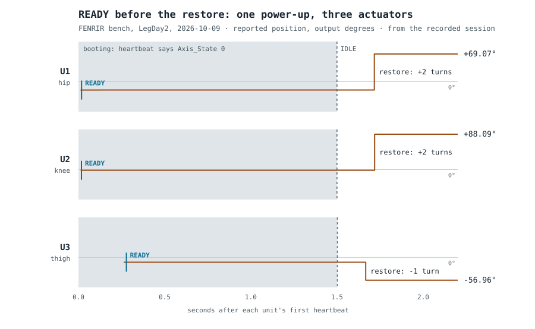

# Ready, before it was

2026-10-08 and 2026-10-09 · Three actuators on one bus. Nothing moved under power.

Until now every reading in these notes came from a laptop asking one actuator questions over
USB. These two sessions are the first with **the robot's own real-time controller running the
bus**: a Teensy 4.1 talking to three actuators at once, recording every frame in both directions
on its own clock, and handing the record to an operator console that shows it live.

The firmware it ran can only ask questions. It cannot command a motor, change a setting or save
anything, and a test in CI enumerates every frame it is able to build to prove that. Over both
sessions it sent nothing but questions: about 70,000 of them.

## Three on one bus

| | |
|---|---|
| Heartbeat, every actuator | **200 per second**, no frame lost while connected |
| Questions answered | 99 % within **2 ms** |
| Longest clean run | **12 minutes**, an emergency stop and its recovery included |

The first session stopped receiving after three minutes, three times, with no error anywhere. It
was running inside a Windows virtual machine; the second ran on the Mac directly and never
stopped. The evidence points at the virtual machine's USB path, and the operator console now
says **LINK STALLED** in red the moment data stops, instead of showing the last numbers as if
nothing had happened. A quiet screen that looks healthy was the more dangerous half of that
failure.

## Ready, before it was

*One real power-up, drawn from the recorded session.*

Power an actuator up and, for **exactly 1.5 seconds**, its heartbeat says it is still booting.
During that time the position it reports is only the motor's angle within its current turn.
Then it goes idle, and a tenth of a second or two later **the power-on restore lands**: it reads
the output-side encoder (the mechanism [this note](2026-08-18-hot-swap-position-verified.md)
verified) and adds whole motor turns. Here that was two, two, and minus one: up to 90 degrees at
the output. Nothing marks the moment. The number simply changes.

Our controller had declared every actuator **ready 17 to 278 milliseconds after its first
heartbeat**, about a second and a half before any of that. And the cross-checks that caught the
earlier faults could not have helped: they compare the *fractions* of a turn the device reports
in different places, and a jump of whole turns leaves every fraction exactly where it was.

**It was the same at all three power-ups we recorded, across two days:** the 1.5 seconds to within
two milliseconds, and the restore inside the same tenth-of-a-second window every time.

This matters more for FENRIR than for most machines. A leg plugged in mid-walk *is* a power-up.
Trusting its position inside that window would put a joint up to 90 degrees from where the robot
believes it is, with every check passing. The shape of the fix is settled: ready only after the
actuator says idle and the latest restore we have seen has had time to land, and any whole-turn
jump after that is a fault. That change comes next, before anything moves.

## What an emergency stop looks like on the wire

When the power is cut, an actuator usually sends **exactly one** last heartbeat carrying an
error code, "motor failed", five milliseconds after a clean one, and then falls silent. The
supply voltage it had reported a fraction of a second earlier was normal. Five times in six it
did that; once it simply went quiet.

So a supervisor cannot wait for a dying joint to announce itself. **Silence has to remain the
signal**, and the error frame is a courtesy when it arrives. All three came back cleanly when the
power returned.

## The noise floor, with its timing beside it

The consistency checks ran about 19,000 times on still shafts. 99 % of them came in under
**3.5 encoder counts**, against a fault threshold of 163.8 and real faults measured at 275 to 287.
That is a comfortable margin on a still shaft. It is also the first floor we have measured with
the timing of every reading recorded beside it, which is what the threshold needs before it can
be trusted on a joint that moves.

## What was not done

No motion, no writes, no configuration changed, no USB session. Every number above comes from the
recorded sessions, through one analysis tool, and the figure is drawn from the same record.
